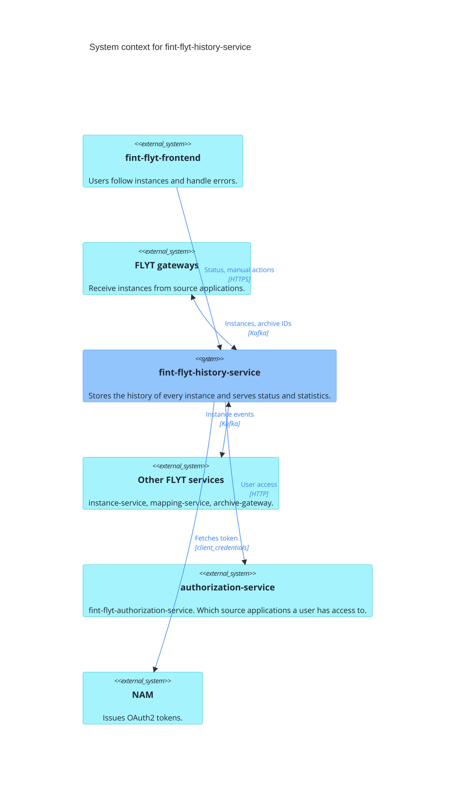
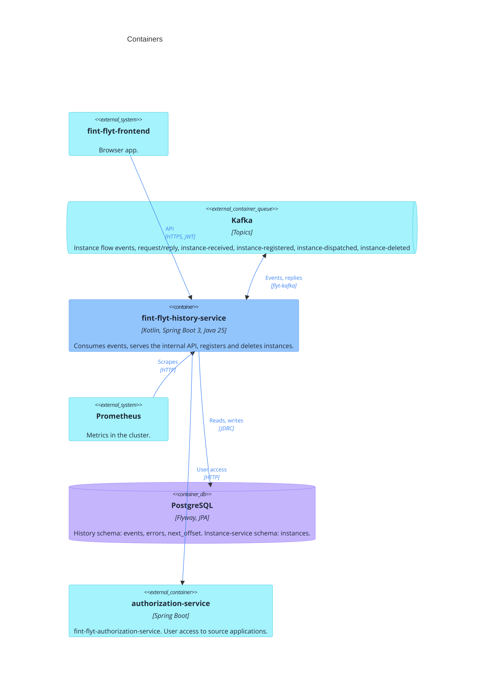
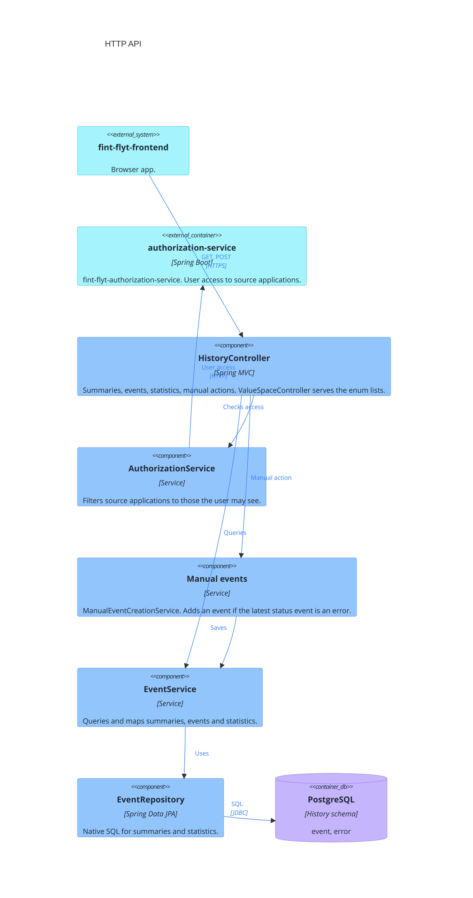
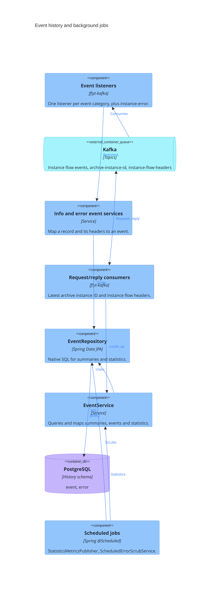
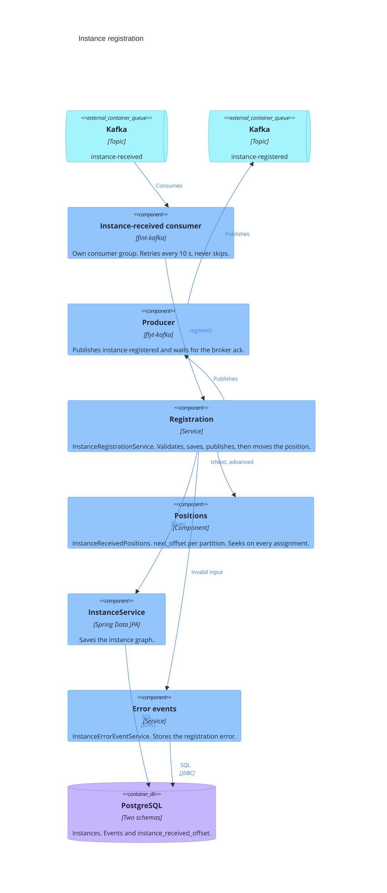
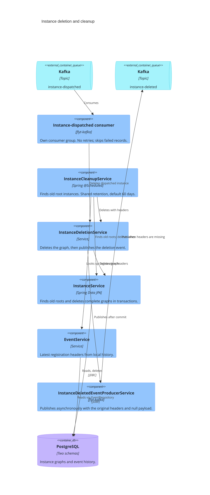

# Architecture

C4 level 1 to 3 for fint-flyt-history-service. Blue is this service, purple is the database,
turquoise is external.

## C4 level 1: System context

Every FLYT service publishes what happens to an instance as events on Kafka. History-service
stores all of them and is the place users go to see where an instance is and to fix failed ones.

- **Gateways** publish `instance-received` and `instance-receival-error`, and ask for the archive
  instance ID of an earlier instance over request/reply (`archive-instance-id`).
- **Other FLYT services** publish the later events in the flow (`instance-registered`,
  `instance-mapped`, `instance-dispatched`, `instance-error`, `instance-deleted` and more).
  Instance-service asks for the instance flow headers of a registered instance over request/reply.
- **Instance registration** is moving from instance-service to history-service. When
  `novari.flyt.instance-functionality.enabled=true`, history-service consumes `instance-received`,
  stores the instance and publishes `instance-registered`, which mapping-service consumes. It is
  off by default. The same flag enables deletion after `instance-dispatched` and daily instance cleanup.
- **Users** call the API from fint-flyt-frontend with a JWT. History-service asks
  authorization-service which source applications the user has access to, with a
  client_credentials token from NAM.

## C4 level 2: Containers

One Spring Boot application and one PostgreSQL database.

- The ingress only routes `/api/intern/instance-flow-tracking`. Swagger UI, OpenAPI and Actuator
  are only reachable inside the cluster.
- The instance tables stay in the instance-service schema in the same database. See
  [Instance schema](../README.md#instance-schema).
- The token for authorization-service comes from NAM (not shown).

## C4 level 3: Components

The components below share the existing database and Kafka infrastructure.

### HTTP API

- Endpoints that return instance data, and the manual actions, check access. Unfiltered queries first read the distinct source application IDs
  from the database and then keep only those the user has access to.
- Manual actions (`instance-manually-processed`, `instance-manually-rejected`,
  `instance-status-overridden-as-transferred`) are stored as events. They are not published to
  Kafka.
- Invalid filters and payloads give 422 through `ValidationErrorsFormattingService`.

### Event history and background jobs

- `EventListenerConfiguration` creates the listeners from `EventCategory`. Info events are stored
  with headers, timestamp and the origin application ID; error events also store the
  `ErrorCollection`. A record that fails is skipped without retry.
- `instance-error` carries the origin of the error, which decides the event category. The five
  older error topics are read while `legacy-error-topic-listeners-enabled` is true.
- The `instance-deleted` listener does nothing for now. Error details are only scrubbed by
  `ScheduledErrorScrubService`, once a day, after the retention period.
- `StatisticsMetricsPublisher` publishes the statistics as Prometheus gauges every minute. See
  [Metrics](../README.md#metrics).

### Instance registration

Off by default (`novari.flyt.instance-functionality.enabled`). The rules for positions, retries and
skipping records are in [Instance registration](../README.md#instance-registration).

For each record, in this order:

1. `InstanceReceivedPositions` decides whether the record is the next one for its partition.
2. `InstanceService` saves the instance in the instance-service schema.
3. `InstanceRegisteredEventProducerService` publishes `instance-registered` and waits for the broker acknowledgement.
4. `next_offset` is set to the record offset + 1 in `instance_received_offset`.

Invalid input is stored as `INSTANCE_REGISTRATION_ERROR` together with the new `next_offset` in one
transaction. The consumer calls `InstanceReceivedPositions` on every partition assignment to seek
to `next_offset` (not drawn). `InstanceRegistrationService` and `InstanceReceivedPositions` read and write
`instance_received_offset` through `InstanceReceivedOffsetRepository` (not drawn).

### Instance deletion and cleanup

The instance functionality flag enables this flow. Registration headers for cleanup are read from local history.

The dispatched consumer uses Kafka commits and a separate group from the ordinary history listener.
A failed delete leaves the instance for later scheduled cleanup. If publication fails after deletion,
the event may be lost. Cleanup without registration headers deletes the graph and logs a warning.
Immediate error-detail scrubbing remains disabled; scheduled scrubbing runs independently.
